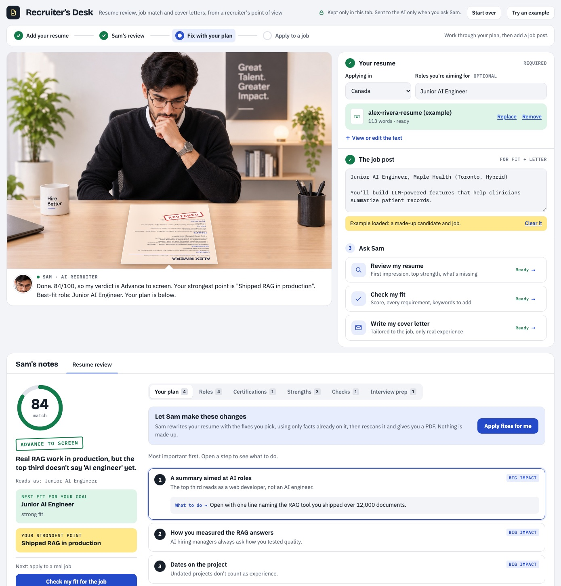

# Recruiter's Desk

A free AI recruiter for job seekers. Put your resume on Sam's desk and he reviews it the way a hiring manager would, checks your fit for a job post, writes a tailored cover letter, and can apply his fixes for you.

### **[Use it free → recruiters-desk.pages.dev](https://recruiters-desk.pages.dev)**

Most people only need that link. Nothing to install, no sign-up.



No subscriptions, no ads, no API keys. Free for the people who use it and for the person who runs it.

## What it does

- **Honest resume review.** A 7-second skim, then a careful read: a score out of 100 added up from six parts (relevance, impact, progression, clarity, credibility, standards), your strongest point, and a numbered plan of what to fix first.
- **Roles you can apply to,** ranked for the roles you're aiming for, with search links to job boards in your region.
- **Certifications worth getting** for the roles you're aiming for, each with what you need first and a link to the issuer's official page.
- **Job-fit check.** Every requirement in a job post marked met, partial or missing, plus the exact keywords to add.
- **Cover letter** in the business-letter format of the country you're applying in.
- **Apply fixes for me.** Sam rewrites your resume with the fixes you tick, reviews it again, and gives you a PDF.
- **Your region's rules.** Canada, United States, United Kingdom, Ireland, Australia, New Zealand, India, Germany, UAE & Gulf, Singapore, or international. Personal details, length, spelling, referees, letter openings and closings, and job boards all follow the region.

## Where the country rules come from

The rules for each region (personal details, length, letter conventions) were checked in November 2026 against sources such as:

- Canada: Ontario Human Rights Commission guidance on application forms; Government of Canada Job Bank.
- United States: EEOC guidance on pre-employment inquiries.
- United Kingdom: [GOV.UK, preventing discrimination in recruitment](https://www.gov.uk/employer-preventing-discrimination/recruitment) and [Acas](https://www.acas.org.uk/recruitment/follow-discrimination-law).
- Ireland: [IHREC, discrimination in recruitment](https://www.ihrec.ie/factsheets/discrimination-against-workers-recruitment-and-promotion).
- Germany: [Bundesagentur für Arbeit, Lebenslauf](https://www.arbeitsagentur.de/bildung/bewerbung/lebenslauf).
- Singapore: [TAFEP, Workplace Fairness Act](https://www.tal.sg/tafep/resources/articles/2026/are-you-ready-for-the-workplace-fairness-act) (due end-2027; the Tripartite Guidelines apply until then).

Where norms are mixed (photos in Germany or the Gulf, personal details in India), the tool says "optional" or "many employers now prefer it left off" rather than calling it wrong. Some regions (Australia, New Zealand, UAE, India) rest mainly on recruiter and university career guidance because official pages don't cover CV content. Corrections are welcome as issues or pull requests.

## Accuracy guards (in code, not left to the AI)

- The score is the sum of the rubric parts, each capped at its maximum.
- Keywords are sorted into "you have" and "to add" by searching your actual resume text for whole words ("Java" isn't counted because you know JavaScript).
- Suggested rewrites are dropped if the original line isn't on your resume, or if the rewrite adds a number your resume doesn't have.
- When Sam applies fixes, the rewrite is refused if it drops any of your dates or your email. Any number that isn't on your original resume is turned into `[X]`.
- An AI answer that comes back cut off is treated as a failed run, never shown as a review.
- A resume or letter PDF can't be downloaded while an `[X]` or `[bracket]` blank is left.
- PDFs are real text (not images), so applicant tracking systems can read them.
- Personal-detail checks (date of birth, marital status, ID numbers and so on) follow your region's norms.
- Certifications come only from a fixed list of about 100 that employers name in job posts, each checked on the issuer's own site (November 2026). The AI picks from the list; the names, requirements and links come from the list itself. Certifications you already hold, ones for other regions, and ones that need more years of experience than your dated jobs show are removed in code. Prices aren't shown because they change.

Scores are a guide to readability and fit, not a prediction of any company's applicant tracking system.

## How it stays free

The page is one HTML file. The only server code is a small relay (`relay/core.js`) that runs as a Cloudflare Pages Function at `/api/relay`.

- **Main path:** the relay sends Sam's request to [Cloudflare Workers AI](https://developers.cloudflare.com/workers-ai/) on its free daily allowance. Each visitor gets a fair share per day, and only Sam's own requests are accepted, so it can't be used as a general chatbot.
- **Backup:** when the day's free allowance is used up, Sam asks you to click **Continue** once and carries on through [Puter.js](https://docs.puter.com/user-pays-model/). Puter's "user-pays" model creates a free guest account (no email or card) whose own free allowance covers your use.
- **Inside claude.ai,** the same file runs as an artifact and uses the viewer's own Claude account.

Nobody pays, and the site holds no AI key.

## Privacy

- **What stays in your browser.** Your resume, job post and Sam's notes are kept only in the open browser tab (sessionStorage). A refresh keeps them, and closing the tab clears them. Only the region you pick is remembered between visits. **Start over** clears everything at once.
- **What gets sent, and when.** Text is sent to an AI only when you click one of Sam's actions:
  - **Usually** it goes through the relay to Cloudflare Workers AI. Cloudflare states it [doesn't use Workers AI content to train models](https://developers.cloudflare.com/workers-ai/platform/data-usage/). The relay stores no resume text. It keeps only a per-visitor count for the day, under a name made from your IP address with a secret key (so the address can't be recovered from it), and deletes it after a day.
  - **When the backup is in use** it goes through Puter to its AI model (see the privacy policy on [puter.com](https://puter.com)).
- **Third-party loads.** Opening the page also loads fonts from Google Fonts and the PDF and Word readers from cdnjs (each script is checked against a published fingerprint). Like any website, those services see your IP address.

## Download it and run it on your own computer

You don't need to. The link above is the full tool. If you'd like your own copy (to keep, study or change):

1. Download it: on the GitHub page, click the green **Code** button, then **Download ZIP**, and unzip it.
2. Open a terminal in the unzipped folder:
   - **Mac:** right-click the folder in Finder, then choose **New Terminal at Folder**.
   - **Windows:** open the folder, then type `cmd` in the address bar and press Enter.
3. Start a tiny local web server:
   - **Mac or Linux:** `python3 -m http.server 8000`
   - **Windows:** `py -m http.server 8000`
4. Open **http://localhost:8000** in your browser.

Your copy uses the same free relay (it accepts copies running on `localhost`), with Puter as the backup. Double-clicking `index.html` isn't enough, because the AI services need a real web address.

If you change the page, edit `app.html` (not `index.html`), then run `./build.sh` to rebuild `index.html`.

## Project layout

| File | What it is |
|---|---|
| `app.html` | The whole app: page, styles and script. It also runs as a claude.ai artifact. |
| `build.sh` | Wraps `app.html` into `index.html`, the full web page. |
| `relay/core.js` | The free AI relay: visitor limit, request checks, call to Workers AI. |
| `functions/api/relay.js` | Serves the relay at `/api/relay` on Cloudflare Pages. |
| `deploy.sh`, `wrangler.toml` | Publish the site and relay to Cloudflare Pages (owner only). |
| `tests/` | Headless-Chrome tests with the AI mocked, plus unit tests for the relay. |

## Tests

```sh
./tests/run.sh             # headless Chrome (the AI is mocked, so no usage) + relay unit tests in Node
```

## Licence

MIT. See [LICENSE](LICENSE).

Sam's feedback comes from an AI and can be wrong. Check every change before you send an application.
